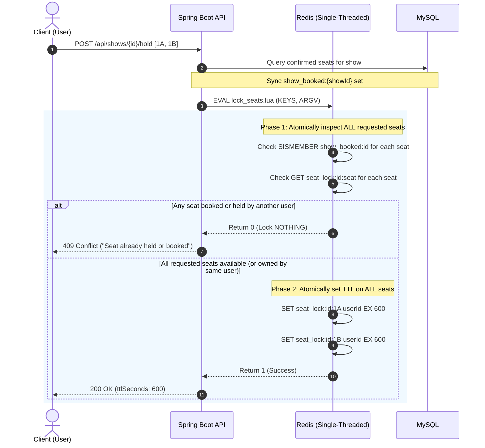
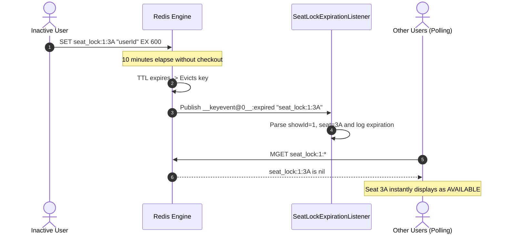
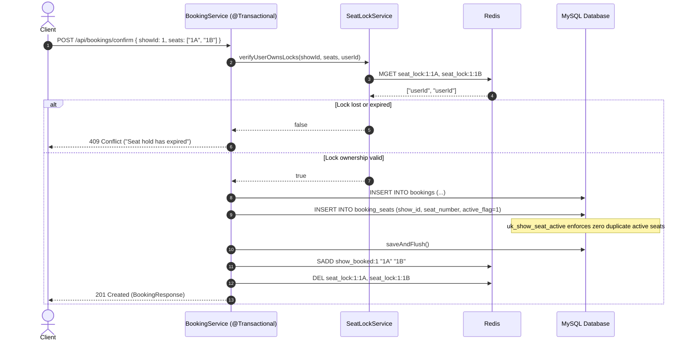
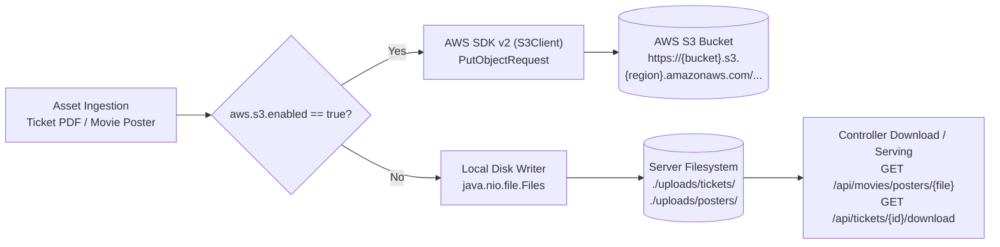

# TakeASeat — Architecture & Technical Deep Dive

This document details the internal design, concurrency controls, atomic operations, storage pipelines, and security mechanisms of the **TakeASeat** platform.

---

## 1. High-Level System Architecture

TakeASeat is built as a decoupled full-stack platform optimized for high concurrency, zero-collision seat allocation, and resilient asset storage:

```mermaid
flowchart TD
    subgraph Client["Client Tier (Angular 19+ Standalone)"]
        UI["Reactive Web UI"]
        PDF["jsPDF Engine"]
        Poller["Seat Map Poller (5s) + 1s Countdown Timer"]
    end

    subgraph Backend["Application Tier (Spring Boot 3.3.4 / Java 17)"]
        Sec["Spring Security (JWT Filter)"]
        Controllers["REST Controllers (/api/*)"]
        LockSvc["SeatLockService (Lua Executor)"]
        BookingSvc["BookingService (@Transactional)"]
        StorageSvc["Storage Services (Poster & Ticket)"]
        Listener["SeatLockExpirationListener"]
    end

    subgraph Data["Persistence & Caching Tier"]
        Redis[("Redis 6+\nAtomic Locks & Sets")]
        MySQL[("MySQL 8.x\nTransactional Record Store")]
    end

    subgraph Storage["Asset Tier"]
        S3["AWS S3 Bucket"]
        Disk["Local Disk Fallback (./uploads)"]
    end

    UI -->|HTTP Bearer JWT| Sec
    Sec --> Controllers
    Controllers --> LockSvc
    Controllers --> BookingSvc
    Controllers --> StorageSvc

    LockSvc -->|EVALSHA / EVAL Lua| Redis
    Redis -.->|"__keyevent@*__:expired"| Listener
    BookingSvc -->|JPA / Hibernate| MySQL
    StorageSvc -->|AWS SDK v2 (if enabled)| S3
    StorageSvc -->|Direct I/O (fallback)| Disk
    PDF -->|Multipart POST /api/tickets/*/upload| StorageSvc
```

---

## 2. Fixed 5×10 Seat Layout (`1A`–`5J`)

### Specifications & Seat Addressing
Every theatre on the platform is physically normalized to a **5 rows × 10 columns grid (50 seats total)**:
- **Rows:** `1` to `5`
- **Columns:** `A` to `J`
- **Identifier Format:** `<RowNumber><ColumnLetter>` (e.g., `1A`, `1B` ... `1J`, `2A` ... `5I`, `5J`).

### Lifecycle & Entity Modeling
1. **Creation:** When an owner creates a theatre via `POST /api/theatres`, [TheatreService.java](file:///c:/Users/Sadik/Desktop/TakeASeat/backend/src/main/java/com/takeaseat/service/TheatreService.java) persists the `Theatre` and automatically executes `generateFixedSeatsForTheatre()`.
2. **Persistence:** Generates 50 [TheatreSeat.java](file:///c:/Users/Sadik/Desktop/TakeASeat/backend/src/main/java/com/takeaseat/entity/TheatreSeat.java) entities linked by foreign key:
   - Unique DB constraint: `uk_theatre_seat (theatre_id, seat_number)`
   - Column `seat_row` (renamed from `row_number` to protect against MySQL 8 reserved keywords) and `col_letter`.
3. **Seat States:**
   - `AVAILABLE`: Neither booked in MySQL nor locked in Redis.
   - `HELD`: Held by another user in Redis (temporary 10-minute hold).
   - `HELD_BY_ME`: Held by the currently authenticated user in Redis.
   - `BOOKED`: Confirmed and permanently committed to MySQL.

---

## 3. High-Concurrency Seat Locking via Redis & Lua Scripts

### The Race Condition Problem
In flash-sale or high-traffic booking platforms, naive "read-then-write" patterns (e.g., checking seat availability in MySQL, then setting a hold) suffer from race conditions. Multiple threads can read a seat as free at the same microsecond and both issue locks, resulting in double bookings or corrupted state.

### Solution: Single-Roundtrip Redis Lua Scripts
TakeASeat offloads atomic validation and locking entirely to Redis execution using Lua scripts, guaranteeing atomicity because Redis executes scripts single-threaded without interleaving other operations.

#### 1. Atomic Hold Script: `lock_seats.lua`
Located at [backend/src/main/resources/scripts/lock_seats.lua](file:///c:/Users/Sadik/Desktop/TakeASeat/backend/src/main/resources/scripts/lock_seats.lua):

- **Keys & Arguments:**
  - `KEYS[1]`: `show_booked:{showId}` (Redis Set storing confirmed seat numbers)
  - `KEYS[2..n+1]`: `seat_lock:{showId}:{seatNumber}` (Redis String key for each requested seat)
  - `ARGV[1]`: `userId` (ID of the reserving user)
  - `ARGV[2]`: `ttlSeconds` (`600` seconds / 10 minutes)
  - `ARGV[3..n+2]`: `seatNumber` corresponding to each lock key



**Key Invariant:** The script features an atomic all-or-nothing guarantee. If an end-user attempts to book `[1A, 1B, 1C]` and seat `1C` is already taken, the script aborts immediately in Phase 1 and returns `0` without placing a lock on `1A` or `1B`.

#### 2. Atomic Release Script: `release_seats.lua`
Located at [backend/src/main/resources/scripts/release_seats.lua](file:///c:/Users/Sadik/Desktop/TakeASeat/backend/src/main/resources/scripts/release_seats.lua):
- **Safety Check:** Verifies `GET seat_lock:{showId}:{seat} == userId` before calling `DEL`.
- Prevents User A from deleting User B's lock if User A's lock had just expired and was grabbed by User B.

#### 3. Optimized Read Path (`MGET`)
For `GET /api/shows/{id}/seats`:
- The backend performs an `opsForValue().multiGet(all50Keys)` in a **single Redis roundtrip**, fetching the holder IDs of all 50 seats simultaneously without issuing 50 independent Redis commands.

---

## 4. Automatic Release via Redis Keyspace Notifications

To ensure that seats abandoned in a user's cart automatically become available to other moviegoers after 10 minutes:



### Server Configuration
Redis does not publish expiration events by default to conserve CPU. It is enabled using:
```bash
redis-cli CONFIG SET notify-keyspace-events Ex
```
- `E`: Keyevent events, published with `__keyevent@<db>__` prefix.
- `x`: Expired events (events generated every time a key with an expiration dies).

### Spring Boot Listener
[SeatLockExpirationListener.java](file:///c:/Users/Sadik/Desktop/TakeASeat/backend/src/main/java/com/takeaseat/config/SeatLockExpirationListener.java) extends Spring Data Redis's `KeyExpirationEventMessageListener`:
- Listens to the `__keyevent@*__:expired` topic.
- Filters keys matching the prefix `seat_lock:{showId}:{seatNumber}`.
- Invokes automated cleanup logging and frees the resource without requiring any manual polling background jobs or scheduled database sweeps.

---

## 5. MySQL Transactional Checkout & Double-Booking Protection

When the user confirms payment within their 10-minute hold window:



### The `active_flag` Pattern for Booking History
A critical design requirement is supporting **ticket cancellations** while preventing double bookings:
- **Challenge:** If you enforce a standard unique index `UNIQUE(show_id, seat_number)`, a cancelled booking prevents that seat from ever being booked again.
- **Solution:** TakeASeat implements `UNIQUE(show_id, seat_number, active_flag)`:
  - When confirmed: `active_flag = 1`. MySQL strictly prohibits two rows with the same `(show_id, seat_number, 1)`.
  - When cancelled: `active_flag` is updated to `NULL`.
  - **SQL Standard Behavior:** In MySQL InnoDB, unique constraints allow multiple `NULL` values. This preserves complete historical records of cancelled bookings while immediately freeing the seat for subsequent bookings.

---

## 6. Asset Storage Architecture: AWS S3 vs Local Disk Fallback

All uploaded assets (client-generated PDF tickets and admin-uploaded movie posters) pass through a dual-mode storage engine configurable via [application.yml](file:///c:/Users/Sadik/Desktop/TakeASeat/backend/src/main/resources/application.yml):



### Implementation Details

#### 1. AWS S3 Integration
- **Client Factory:** [AwsS3Config.java](file:///c:/Users/Sadik/Desktop/TakeASeat/backend/src/main/java/com/takeaseat/config/AwsS3Config.java) provides an `@Bean` `S3Client` conditioned on `@ConditionalOnProperty(name = "aws.s3.enabled", havingValue = "true")`.
- **Credentials:** Supports static credentials (`aws.access-key`, `aws.secret-key`) or falls back cleanly to the AWS SDK `DefaultCredentialsProvider` (IAM instance profiles, environment variables, `~/.aws/credentials`).
- **Ticket Keys:** `tickets/{bookingReference}.pdf`
- **Poster Keys:** `posters/{uuid}.{ext}`

#### 2. Local Disk Fallback (`aws.s3.enabled: false`)
- No cloud account or external dependencies are required for local development.
- Files are saved to `./uploads/tickets` and `./uploads/posters` with directory traversal protection (`Path.normalize().startsWith(baseDir)`).
- **Bundled Default Posters:** Seeded movies have SVG posters bundled inside `src/main/resources/default-posters/` and served via `ClassPathResource` so the platform has rich visuals out of the box.

---

## 7. Client-Side PDF Ticket Generation (`jspdf`)

To offload PDF rendering from backend CPU cores, ticket generation happens directly inside the user's browser using `jspdf`:

1. **Generation:** When a booking is confirmed, [TicketPdfService.ts](file:///c:/Users/Sadik/Desktop/TakeASeat/frontend/src/app/core/services/ticket-pdf.service.ts) generates a printable A5 e-ticket complete with:
   - Header branding banner
   - Unique reference code (`TAS-YYYYMMDD-XXXXXX`)
   - Movie title, theatre location, showtime, and seat breakdown
   - Total amount paid and issuance timestamp
2. **Instant Download:** The user can click **Download PDF Ticket** at any time to invoke `doc.save()`.
3. **Background Archiving:** Simultaneously, the frontend converts the document to a binary `Blob` (`doc.output('blob')`) and uploads it to `POST /api/tickets/{bookingId}/upload` via `FormData`, archiving the ticket in S3 or local storage for audit records and retrieval.

---

## 8. Role-Based Access Control & Security Model

Authentication uses stateless JWT (JSON Web Tokens) signed via HMAC-SHA256 with a 24-hour expiration window.

### Roles & Responsibilities

| Role | Permissions | Accessible Routes |
|---|---|---|
| `ROLE_USER` | Browse movies/theatres, view seat maps, hold seats, book tickets, download personal PDF tickets, cancel personal bookings | `/user/movies`, `/user/movies/:id`, `/user/shows/:id/seats`, `/user/bookings` |
| `ROLE_OWNER` | Create theatres (with auto-generated 5×10 seats), remove own theatres, schedule movie showtimes with pricing, cancel own shows, view show booking counts | All user routes + `/owner` |
| `ROLE_ADMIN` | Add movies to platform catalog (with mandatory PC file/URL poster upload), remove movies, delete any theatre, view all system bookings, cancel any user's ticket | All user routes + `/admin` |

### Guard Implementations
- **Backend:** Enforced with `@PreAuthorize("hasRole('ADMIN')")`, `@PreAuthorize("hasRole('OWNER')")`, or `@PreAuthorize("hasAnyRole(...)")` on controller methods, accompanied by an `AccessDeniedHandler` returning clean JSON error responses.
- **Frontend:** Protected by functional Angular guards [authGuard](file:///c:/Users/Sadik/Desktop/TakeASeat/frontend/src/app/core/guards/role.guard.ts) and `roleGuard(['ROLE_ADMIN'])` redirecting unauthorized attempts back to the user's default dashboard.

---

## 9. Verification & Seed Data Summary

On initial launch against `BookASeat_DB`, [DataSeeder.java](file:///c:/Users/Sadik/Desktop/TakeASeat/backend/src/main/java/com/takeaseat/config/DataSeeder.java) populates:

- **Admin Account:** `admin@takeaseat.com` / `admin123`
- **Owner Account:** `owner@takeaseat.com` / `owner123`
- **User Account:** `user@takeaseat.com` / `user123`
- **Catalog Movies:** *Interstellar*, *The Grand Budapest Hotel*, *Dune: Part Two* (all linked to vector posters)
- **Theatres:** *Grand Cinema Screen 1* (Bengaluru) & *Metroplex Downtown* (Mumbai), both initialized with 50 seats (`1A`–`5J`)
- **Upcoming Shows:** 4 scheduled shows with varying price points (₹200 – ₹350)
